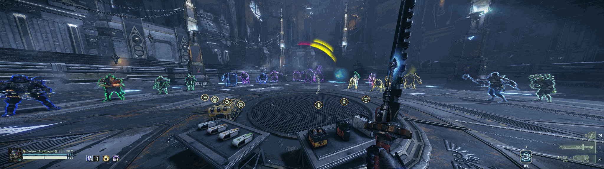

# Darktide Greyscale



A small Darktide Mod Framework mod that desaturates the gameplay view in **Warhammer 40,000: Darktide**. Use it for a muted world, less colour clutter, or a Chromatix-inspired appearance alongside coloured enemy outlines.

- Adjustable desaturation from **0–100%**, in **5% steps**.
- Default desaturation: **90%**. **Enable Greyscale defaults Off**.
- Change settings during gameplay without restarting.
- Preserves the game's normal environment blending and restores native shading when disabled or set to 0%.
- Does not change enemy materials, outline colours, lighting, exposure, fog, bloom or textures.

## Requirements

- Warhammer 40,000: Darktide on PC.
- [Darktide Mod Framework (DMF)](https://github.com/Darktide-Mod-Framework/Darktide-Mod-Framework) and the mod-loader setup required by DMF.

**Enemies Improved is optional.** Enemies Improved 3.0.8 with custom coloured outlines was used during testing; it is not bundled or required.

## Installation

Download **Darktide_Greyscale-v0.1.1.zip** from the [v0.1.1 release](https://github.com/FartmanAndBurps/darktide-greyscale/releases/tag/v0.1.1). Use that install ZIP rather than GitHub's automatically generated source-code archives.

### Windows

1. Close Darktide. Ensure your existing DMF/mod-loader installation works.
2. In Steam, open Darktide → Properties → Installed Files → Browse.
3. Back up `mods/mod_load_order.txt`. For an update, also back up the existing `mods/Darktide_Greyscale` folder.
4. Extract the ZIP's **Darktide_Greyscale** folder into the game's **mods** folder. The manifest must be at:

   ```text
   mods/Darktide_Greyscale/Darktide_Greyscale.mod
   ```

5. Add the following entry to `mods/mod_load_order.txt`, after `dmf`:

   ```text
   Darktide_Greyscale
   ```

6. Keep every other mod entry intact. Use your loader's documented enable/patch procedure if required, then launch Darktide.

### Linux / Steam Proton

Follow the same folder and load-order steps above. Steam's **Browse** button finds the correct installation even with custom libraries or Flatpak Steam. Extract the folder into the actual game's `mods` directory, not a Proton prefix or a second nested mod folder. Linux filenames are case-sensitive: keep **Darktide_Greyscale** exactly as supplied.

Use the Linux/Proton procedure for your existing loader. This mod requires no additional DLL, shader injector or Proton launch-option changes.

When updating, replace only this mod's folder and keep exactly one `Darktide_Greyscale` load-order entry.

## Settings

Open **Mod Options → Darktide Greyscale**:

| Setting | Default | Behaviour |
|---|---|---|
| Enable Greyscale | Off | Enables or disables the effect. |
| Desaturation | 90 | 0 restores native shading; 100 requests full greyscale. Adjustable in steps of 5. |

Changes apply on the next valid gameplay shading callback. Existing saved values are retained across updates; upgrading from an older default does not automatically change a saved 80 to 90.

## Disable, uninstall and rollback

Set **Enable Greyscale Off** or **Desaturation 0** to return to native rendering. Disabling the mod through DMF also restores its active overrides.

To uninstall, close the game, remove only the `Darktide_Greyscale` line from `mods/mod_load_order.txt`, and move its folder out of `mods`. Leave other mods and game files unchanged. To roll back an update, restore the mod-folder backup. Saved DMF settings for this mod may remain and do not need manual removal.

## Testing and limitations

v0.1.1 has been tested successfully through full missions on **Fedora Linux through Proton**, with adjustable desaturation and Enemies Improved's coloured outlines. The outline colours remained vivid during that testing.

**This mod does not selectively exclude enemy outlines from greyscale processing.** The exact rendering interaction is not fully established, and results may differ with game updates, native tagging/talents, other visual mods or renderer settings. Native colour grading may leave a tint at 100%.

- Windows is an installation target, but the reported full-mission testing was on Fedora/Proton.
- HDR, FSR and frame generation are not modified. Compatibility across all combinations is not proven.
- The mod does not hook menu/UI worlds, but scene-rendered HUD elements can be affected. Check readability with your setup.
- Other mods that modify the same greyscale parameters can conflict by load order.
- Loading/shutdown and missing API errors are protected. An unsupported API or rejected parameter suspends the effect with one warning until a setting change or re-enable.
- No performance improvement is promised.

v0.1.1 fixes the startup localisation formatting error in the old desaturation label and sets the default to 90%.

## Development

The source is under `mods/Darktide_Greyscale`. Native game and DMF API references are recorded in [docs/SOURCES.md](docs/SOURCES.md); no game assets or third-party mod source are included.

With an existing LuaJIT executable, run the mock tests from the project root:

```sh
DG_ROOT="$PWD" luajit tests/test_mod.lua
```

Alternatively, `tools/run_tests.py` parses all Lua/manifest files and runs the mocks using an existing Lua 5.1/LuaJIT shared library:

```sh
DG_LUA_LIBRARY="/path/to/your/existing/luajit-library" python3 tools/run_tests.py
```

The mocks cover callback values, restoration, settings changes, invalid states, viewport teardown and localisation formatting. They are not a substitute for renderer testing.

Build an install ZIP with Python 3:

```sh
python3 tools/package.py
```

The build uses a fixed public-file allowlist and refuses to overwrite an existing ZIP. Move an existing build aside before rebuilding. Outputs are in `dist/` and are excluded from Git.

## Licence

Original implementation and project tooling are available under the [MIT licence](LICENSE). Warhammer 40,000: Darktide and its assets belong to their respective owners; none are included. This is an unofficial mod and is not affiliated with Fatshark or Games Workshop.
